<div align="center">


# ترب حضوری

**دستیار هوشمند خرید حضوری از مغازه‌ها و پاساژهای تهران**

<p dir="rtl">«تا دم مغازه همراهتم؛ قبل از اینکه راه بیفتی می‌دونی کجا بری، چقدر بدی، و اگه نداشت کجا بری.»</p>


<br/>

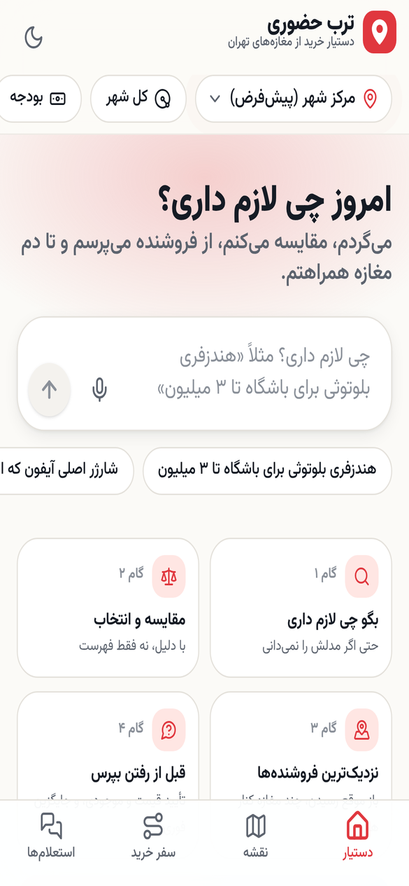
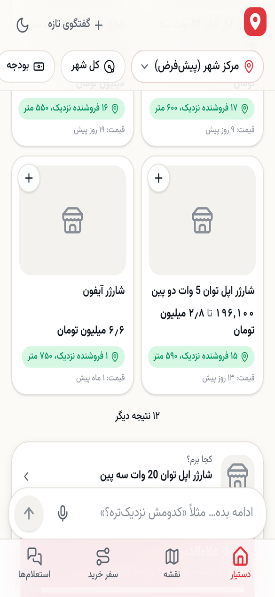
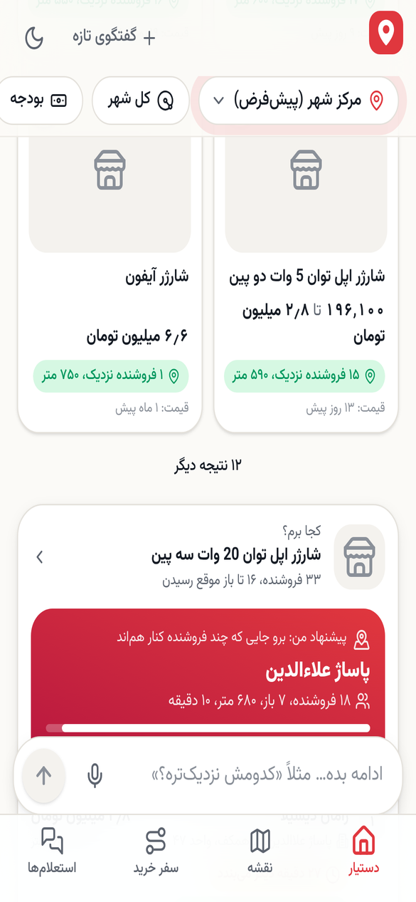
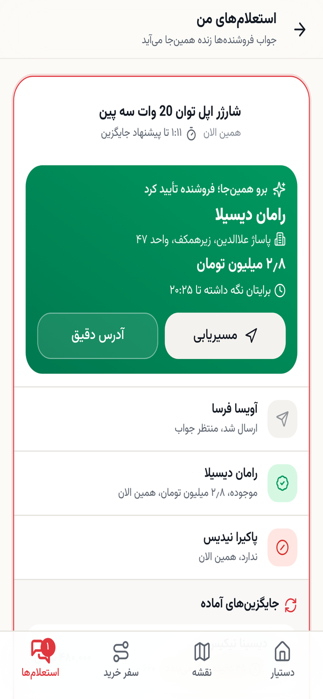

</div>

<div dir="rtl">

## فهرست

- [مسئله](#مسئله)
- [راه‌حل در یک نگاه](#راهحل-در-یک-نگاه)
- [تجربه کاربری: سفر کاربر](#تجربه-کاربری-سفر-کاربر)
- [فیچرها](#فیچرها)
- [هوشمندی دستیار](#هوشمندی-دستیار)
- [شفافیت داده](#شفافیت-داده)
- [معماری فنی](#معماری-فنی)
- [اجرای محلی](#اجرای-محلی)
- [دیپلوی روی لیارا](#دیپلوی-روی-لیارا)
- [تست و کیفیت](#تست-و-کیفیت)
- [سناریوی دمو](#سناریوی-دمو)
- [ایده‌های بعدی](#ایدههای-بعدی)

---

## مسئله

خرید حضوری در بازار تهران هنوز پر از حدس و رفت‌وآمد بی‌نتیجه است:

| درد | چه اتفاقی می‌افتد |
|---|---|
| مدل را نمی‌دانم | ده‌ها مدل مشابه؛ نمی‌دانم کدام برای نیاز من مناسب است |
| قیمت قدیمی است | قیمت ثبت‌شده مال هفته‌ها پیش است و موجودی معلوم نیست |
| رفتم، نداشت / بسته بود | یک مسیر کامل در ترافیک، دست خالی |
| پاساژ را پیدا کردم، مغازه را نه | «طبقه دوم، واحد ۲۳۱» در یک پاساژ ۲۰۰ مغازه‌ای |
| شرایط خرید | قسطی می‌دهد؟ گارانتی دارد؟ ساعت ۸ شب باز است؟ |

## راه‌حل در یک نگاه

ترب حضوری چهار گام چالش را به یک تجربه پیوسته تبدیل می‌کند و هر گام را یک قدم جلوتر می‌برد:

| گام چالش | در ترب حضوری |
|---|---|
| **۱. انتخاب مدل** | گفتگوی طبیعی فارسی (متن یا صدا) ← نتایج **فوری** ← ۳ پیشنهاد برچسب‌دار با دلیل واقعی ← یک سؤال روشن‌کننده با گزینه‌های لمسی ← جدول مقایسه |
| **۲. فروشگاه‌های نزدیک** | رتبه‌بندی بر اساس فاصله، زمان رسیدن، **باز بودن در لحظه رسیدن** و **خوشه فروشنده‌ها** (چند مغازه کنار هم = شانس بیشتر) |
| **۳. مقایسه فروشگاه‌ها** | امتیاز قابل توضیح (Visit Score) با چیپ‌های «چرا پیشنهاد شد»، سنجه قیمت منصفانه، تازگی قیمت، گارانتی، پرداخت قسطی، نقشه با پین قیمت |
| **۴. ارتباط با فروشنده** | استعلام یک‌لمسی از چند فروشنده ← **پنل فروشنده** با پاسخ یک‌لمسی و رزرو ← وضعیت **زنده** در همان گفتگو ← اگر جواب نداد یا نداشت، **جایگزین خودکار** |

و فراتر از چهار گام: **حالت داخل پاساژ** (طبقه، واحد و مسیر بازدید)، **سفر خرید چندقلمی** با کمترین توقف، **لیست خرید پروژه‌ای**، **برنامه‌ریزی برای زمان مراجعه** («امشب ساعت ۸»)، و **گزارش حضوری** «رسیدم، بسته بود / نداشت».

## تجربه کاربری: سفر کاربر

<table>
<tr>
<td align="center"><br/><sub>خانه: بگو چی لازم داری</sub></td>
<td align="center"><br/><sub>پیشنهاد دستیار با دلیل</sub></td>
<td align="center"><br/><sub>«کجا برم؟»: خوشه و فروشنده‌های برتر</sub></td>
</tr>
<tr>
<td align="center">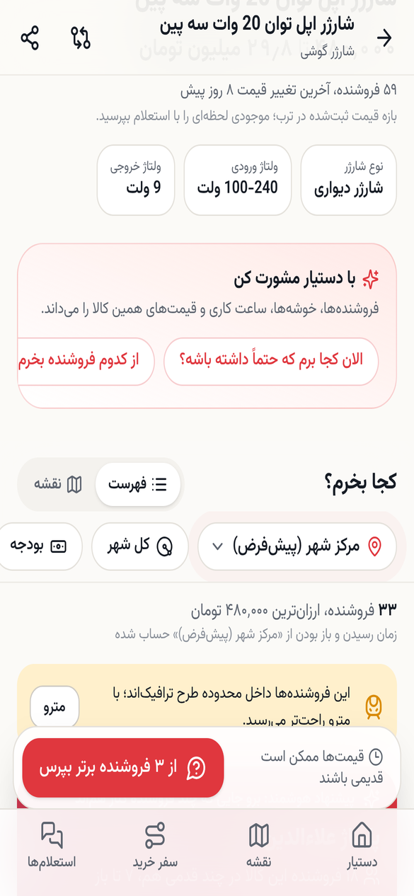<br/><sub>صفحه محصول و مشورت با دستیار</sub></td>
<td align="center">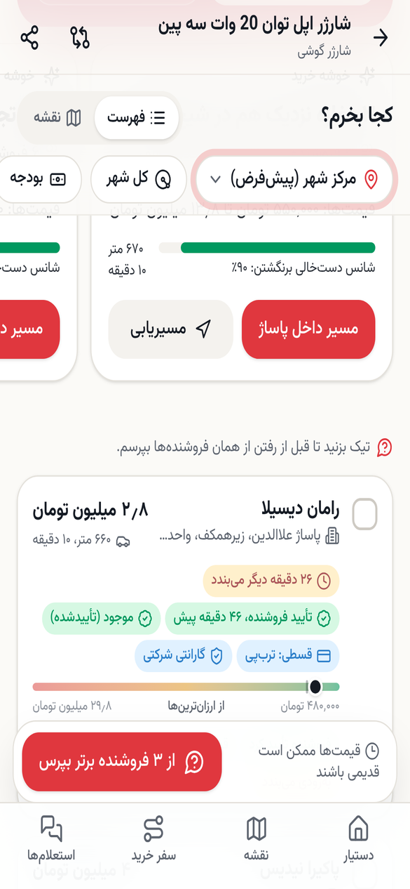<br/><sub>مقایسه فروشنده‌ها با نشان‌های شفافیت</sub></td>
<td align="center">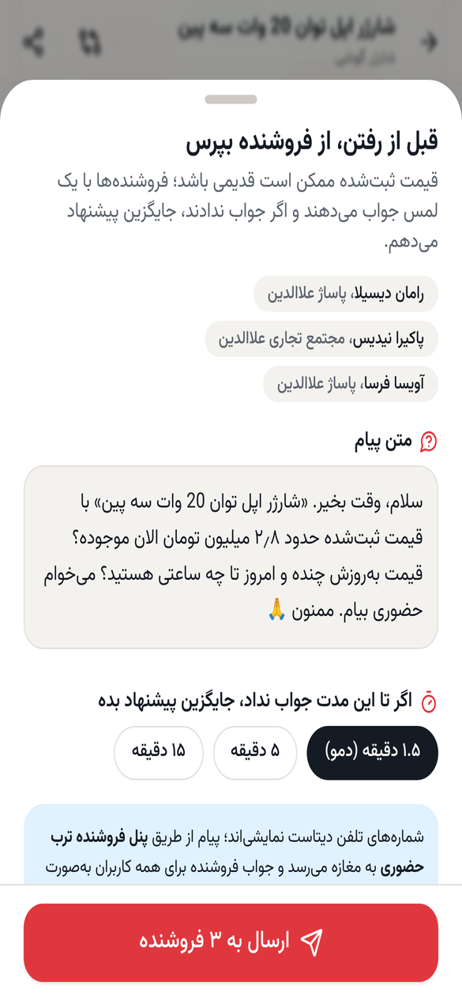<br/><sub>استعلام از چند فروشنده</sub></td>
</tr>
<tr>
<td align="center">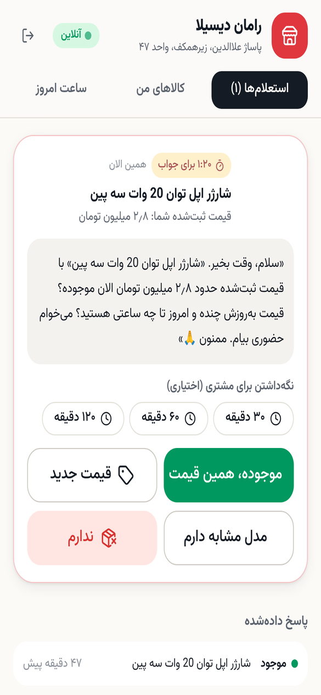<br/><sub>پنل فروشنده: پاسخ یک‌لمسی</sub></td>
<td align="center"><br/><sub>تأیید زنده و جایگزین آماده</sub></td>
<td align="center">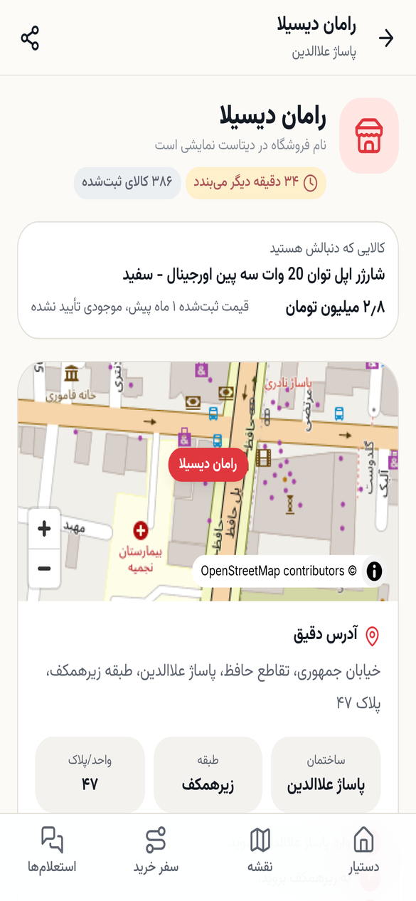<br/><sub>آدرس دقیق: پاساژ، طبقه، واحد</sub></td>
</tr>
<tr>
<td align="center">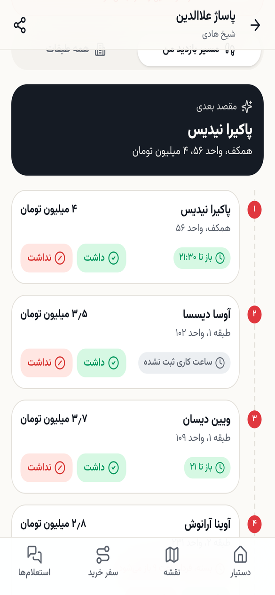<br/><sub>حالت «توی پاساژم»: مسیر بازدید</sub></td>
<td align="center">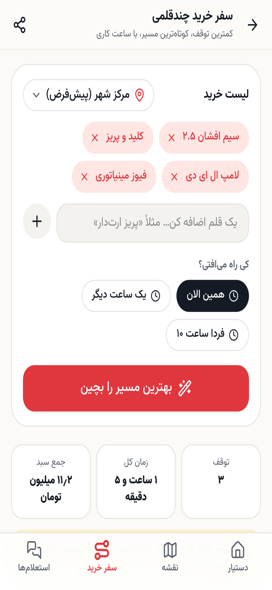<br/><sub>سفر خرید چندقلمی</sub></td>
<td align="center">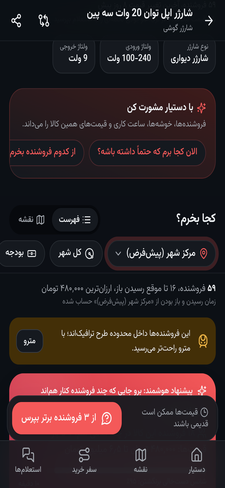<br/><sub>حالت تاریک</sub></td>
</tr>
</table>

> تصاویر محصولات از CDN ترب بارگذاری می‌شوند. در محیط ساخت این اسکرین‌شات‌ها دسترسی به آن CDN نبود و به‌جایش نگهدارنده نمایش داده شده است.

### اصول طراحی

- **چت کمکی است، نه اجباری.** هر پاسخ دستیار یک کارت تعاملی است و هر کارت قدم بعد را دارد («بپرس»، «مسیریابی»، «مقایسه»). همه مسیرها بدون تایپ هم با دکمه و فیلتر قابل انجام‌اند.
- **صبر نکن.** نتایج جستجو، کارت «کجا برم» و خوشه‌ها در کسری از ثانیه می‌آیند؛ تحلیل هوشمند بعداً اضافه می‌شود و در این فاصله وضعیت صادقانه نمایش داده می‌شود («دارم تازگی قیمت‌ها را چک می‌کنم…»).
- **نوار زمینه ثابت.** محدوده، بودجه، زمان مراجعه، باز موقع رسیدن، قسطی، گارانتی و «فقط تأییدشده» همیشه در دسترس‌اند و نتایج را زنده عوض می‌کنند. هرچه کاربر در جمله گفته («قسطی، تا ۳ میلیون، امشب») خودکار روی همین نوار می‌نشیند تا با یک لمس قابل تغییر باشد.
- **موبایل‌محور و فارسی واقعی:** راست‌به‌چپ کامل، اعداد و قیمت فارسی («۴۲٫۵ میلیون تومان»)، تاریخ نسبی، bottom sheet، haptic، skeleton، انیمیشن‌های نرم، حالت تاریک، PWA قابل نصب، ورودی صوتی fa-IR.
- **هیچ بن‌بستی نیست.** اگر چیزی پیدا نشد، محدودیت‌ها یکی‌یکی شل می‌شوند و دقیقاً گفته می‌شود کدام شل شد.

## فیچرها

<details open>
<summary><b>کشف نیاز و انتخاب مدل</b></summary>

- فهم جمله فارسی محاوره‌ای در لحظه: بودجه («تا ۳ میلیون»، «۶۰ تا ۱۲۰»، «۲ تومن»)، زمان («امشب ساعت ۸»، «فردا صبح»، «پنجشنبه عصر»)، مکان («نزدیک ونک»)، شرایط (قسطی، گارانتی، ترب‌پی، الان باز، پیاده، مترو) و حذف کلمات محاوره‌ای («کجا برم که مطمئن باشم داره»).
- جستجوی مقاوم: نرمال‌سازی فارسی، هم‌معنی‌ها (هندزفری ↔ هدفون ↔ ایرپاد)، غلط تایپی (هنذفری بلوتوس)، تقویت دسته درست («لپ تاپ» ← لپ‌تاپ، نه کیف لپ‌تاپ)، و حذف هوشمند کلمه‌ای که نتیجه را صفر می‌کند («باشگاه» در «هندزفری باشگاه»).
- ۳ پیشنهاد برچسب‌دار («به‌صرفه‌ترین منطقی»، «بهترین ارزش»، «راحت‌ترین برای پیدا کردن») با دلیل‌های واقعی از مشخصات، قیمت و تعداد فروشنده نزدیک.
- سؤال روشن‌کننده با گزینه‌های لمسی، جدول مقایسه کنار هم با «فقط تفاوت‌ها»، و جایگزین مشابه.

</details>

<details open>
<summary><b>کجا بخرم؟ فروشنده‌ها، خوشه‌ها و شرایط مراجعه</b></summary>

- **خوشه خرید:** فروشنده‌های یک کالا که در یک پاساژ یا چند قدمی هم‌اند گروه می‌شوند و «شانس دست‌خالی برنگشتن» محاسبه می‌شود.
- **باز در لحظه رسیدن:** زمان رسیدن (پیاده، ماشین با ضریب ترافیک ساعتی، مترو) با شیفت‌های کاری روز جمع می‌شود: «۲۹ دقیقه دیگر می‌بندد»، «بسته؛ فردا ساعت ۹ باز می‌شود».
- **برنامه‌ریزی برای بعد:** «ساعت ۸ شب میرم» ← همه رتبه‌بندی‌ها برای همان ساعت.
- **Visit Score قابل توضیح** با چهار preset (متعادل، ارزان‌ترین، نزدیک‌ترین، مطمئن‌ترین) و دلیل‌های قطعی (نه حدسِ مدل زبانی).
- **سنجه قیمت منصفانه** و هشدار «خیلی ارزان‌تر از بقیه؛ شاید قیمت قدیمی باشد».
- **طرح ترافیک:** هشدار و پیشنهاد مترو برای مرکز شهر.
- **«شاید داشته باشند»:** مغازه‌های هم‌صنف نزدیک که این کالا را ثبت نکرده‌اند، جدا و با برچسب صادقانه.

</details>

<details open>
<summary><b>قبل از رفتن بپرس: پنل فروشنده و پیگیری زنده</b></summary>

- استعلام از ۱ تا ۶ فروشنده با پیام آماده و قابل ویرایش، و مهلت جواب (۹۰ ثانیه در دمو تا ۱۵ دقیقه).
- پنل فروشنده (PWA موبایل): صدا و لرزش برای استعلام تازه، شمارش معکوس، پاسخ یک‌لمسی («موجوده»، «قیمت جدید»، «ندارم»، «مدل مشابه دارم»)، **رزرو برای مشتری** ۳۰ تا ۱۲۰ دقیقه، اعلام ساعت امروز، و تأیید موجودی کالاها با یک لمس.
- هر جواب فروشنده یک **تأیید عمومی** است: تا ۲۴ ساعت روی کارت آن مغازه برای همه کاربران «تأیید فروشنده، X دقیقه پیش» می‌خورد و در رتبه‌بندی بالا می‌رود.
- وضعیت زنده (SSE روی Postgres LISTEN/NOTIFY) در همان گفتگو، در صفحه استعلام‌ها و روی badge ناوبری.
- **جایگزین خودکار:** با تمام شدن مهلت یا جواب «ندارم»، فروشنده‌های باز نزدیک (اول از همان خوشه) و مدل‌های مشابه پیشنهاد می‌شوند و با یک لمس از آن‌ها هم پرسیده می‌شود.

</details>

<details open>
<summary><b>داخل پاساژ و سفر خرید</b></summary>

- **۲۹۷ پاساژ و مجتمع** از روی آدرس‌ها شناسایی و نام‌های مختلف یکی شده‌اند (علاالدین، علاءالدین، علائدین).
- آدرس دقیق: ساختمان، طبقه (همکف، زیرهمکف، منفی دو و…)، واحد، و همسایه‌های همان طبقه به‌عنوان نشانه.
- **مسیر بازدید داخل پاساژ:** طبقه‌به‌طبقه با کمترین بالا و پایین رفتن، با چک «داشت / نداشت» که به‌صورت گزارش جمعی ثبت می‌شود.
- **«رسیدم، بسته بود / نداشت»:** نزدیک‌ترین جایگزین باز در فاصله پیاده‌روی از همان مغازه.
- **سفر چندقلمی:** set-cover حریصانه و ترتیب‌دهی nearest-neighbor + 2-opt با محدودیت ساعت کاری؛ تایم‌لاین، جمع سبد، نقشه و لینک اشتراک.
- **لیست خرید پروژه‌ای:** «برای برق‌کشی یه واحد ۸۰ متری چی لازم دارم؟» ← اقلام با مقدار تقریبی و دلیل ← «همه را در یک سفر بخر».
- **چک‌لیست خرید حضوری** مخصوص هر دسته (اصالت، گارانتی، تست، رجیستری) که یک بار تولید و کش می‌شود. این همان توصیه ترب است که پرداخت بعد از اطمینان از صحت کالا انجام شود.

</details>

## هوشمندی دستیار

دستیار دو لایه دارد، چون مدل زبانی برای هر مرحله ۱۰ ثانیه یا بیشتر زمان می‌خواهد و کاربر نباید منتظر بماند:

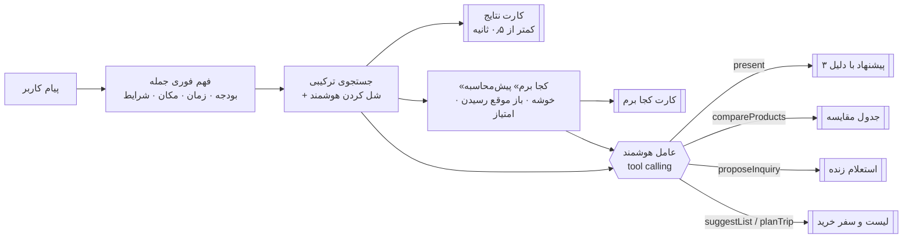

**ابزارهای عامل**

| ابزار | کار | خروجی در UI |
|---|---|---|
| `present` | ۳ پیشنهاد برچسب‌دار + یک سؤال + قدم‌های بعدی | کارت «پیشنهاد من» و چیپ‌ها |
| `searchCatalog` | جستجوی دوباره با عبارت بهتر | (ورودی مرحله بعد) |
| `compareProducts` | مقایسه با شناسه یا **فقط با نام** | جدول مقایسه |
| `findShops` | رتبه‌بندی فروشنده‌ها برای مبدأ و زمان کاربر | کارت فروشنده‌ها و خوشه |
| `proposeInquiry` | استعلام آماده، خودکار از ۳ فروشنده برتر باز | کارت ارسال و وضعیت زنده |
| `suggestList` | لیست خرید پروژه‌ای با مقدار و دلیل | چک‌لیست و دکمه سفر |
| `planTrip` | سفر خرید چندقلمی | تایم‌لاین |
| `myInquiries` | «جواب دادن؟» | وضعیت زنده استعلام‌ها |

**قوانین حفاظتی:**
- هیچ قیمت، موجودی، ساعت یا آدرسی از خود مدل ساخته نمی‌شود؛ همه از ابزارها یا داده‌های پیش‌محاسبه‌شده می‌آیند.
- «قیمت ثبت‌شده» هیچ‌وقت «موجودی تأییدشده» معرفی نمی‌شود.
- ابزارهایی که کارت کامل می‌سازند گفتگو را همان‌جا تمام می‌کنند تا رفت‌وبرگشت اضافه و کند پیش نیاید.
- سلام و احوال‌پرسی پاسخ فوری و ثابت دارد.
- اگر مدل در دسترس نباشد یا دیر کند، پیشنهادهای قاعده‌محور جایگزین می‌شوند.

**ارزیابی واقعی:** ۹ سناریوی فارسی چندمرحله‌ای قبل و بعد از بهینه‌سازی، با مدل `claude-mythos-preview` روی یک endpoint سازگار با OpenAI اجرا شد:

| سناریو | قبل | بعد |
|---|---|---|
| «فرق ایرپاد پرو ۲ با انکر R50i؟» | ۶۷ ثانیه، ۳ مرحله | **۵ ثانیه**، ۱ مرحله |
| «از سه فروشنده اول بپرس» | ۴۵ ثانیه، **استعلام ارسال نشد** | **۴ ثانیه**، استعلام آماده |
| «شارژر اصلی آیفون؛ کجا برم که مطمئن باشم؟» | ۲۶ ثانیه، محصول کم‌فروشنده | کارت «کجا برم» فوری و پاسخ کامل در ۱۳ ثانیه |
| «برق‌کشی یه واحد ۸۰ متری» | فقط سیم | **لیست کامل** با مقدار و سفر خرید |
| «ساعت ۸ شب میرم…» | زمان نادیده گرفته شد | ساعت کاری برای **ساعت ۲۰** حساب شد |
| «سلام، تو کی هستی؟» | ۲۱ ثانیه | **۰٫۲ ثانیه** |
| مشورت از صفحه محصول | وجود نداشت | «از X بخر، تأییدشده و نزدیک‌ترین؛ فقط ۳۵ دقیقه دیگر می‌بندد» |

## شفافیت داده

دیتاست کامل ترب پروفایل شد و هر محدودیت آن در UI به یک برچسب صادقانه تبدیل شد. صفحه `/data` همین گزارش را زنده نشان می‌دهد.

| واقعیت دیتاست | در ترب حضوری |
|---|---|
| ۶٬۴۷۶ فروشگاه؛ فقط ۳٬۷۹۲ تا کالای مشخص ثبت کرده‌اند | دو سطح: «ثبت‌شده، موجودی تأیید نشده» و «فقط صنف مرتبط، نامشخص» |
| حدود ۸۵٪ فروشگاه‌ها در فردوسی، شیخ‌هادی و بهارستان | خوشه خرید و شانس دست‌خالی برنگشتن محور پیشنهادهاست |
| ۵۹٪ آدرس‌ها پاساژ دارند، ۶۵٪ طبقه، ۹۳٪ واحد یا پلاک | پارسر آدرس، صفحه پاساژ و مسیر بازدید |
| ۲٬۰۲۹ فروشگاه همه روزها را «بسته» ثبت کرده‌اند (یعنی اعلام نکرده‌اند) | «ساعت کاری ثبت نشده»، نه «بسته» |
| شیفت‌های `00:00-00:00` جاخالی‌اند؛ برخی شیفت‌ها از نیمه‌شب می‌گذرند | محاسبه درست شیفت‌های شبانه |
| ۲۶۶ فروشگاه خرید اعتباری اعلام کرده‌اند (ترب‌پی، اسنپ‌پی، دیجی‌پی، تارا) با نوع پذیرش `in_person` یا `unknown` | «ترب‌پی، پذیرش حضوری» یا «نوع پذیرش اعلام نشده» |
| ۱٬۷۹۲ قیمت پرت (کمتر از ۱۰۰۰ یا بیشتر از ۵۰ میلیارد تومان) و ۱۵٬۰۸۳ آفر بی‌قیمت | «قیمت نامعتبر» و «قیمت ثبت نشده، بپرسید»؛ حذف از آمار |
| تاریخ تغییر قیمت از ۲۰۲۰ تا ۲۰۲۶ | نشان تازگی: تازه / ثبت‌شده / قدیمی‌تر / قدیمی، همیشه جدا از «تأیید فروشنده» |
| نام بیشتر فروشگاه‌ها و همه شماره‌ها جعلی است | «شماره نمایشی دیتاست» و ارتباط واقعی از طریق پنل فروشنده |
| ۳۵٬۲۵۴ محصول دو فروشنده یا بیشتر دارند (حداکثر ۵۹) | سنجه قیمت منصفانه و مقایسه فروشنده‌ها |

## معماری فنی

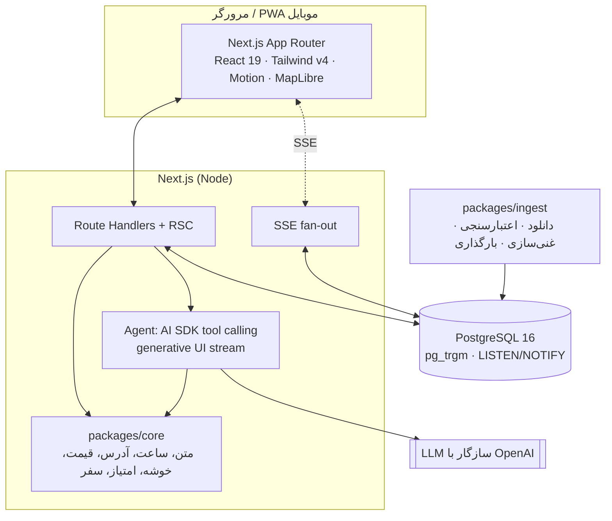

**ساختار مونوریپو** (pnpm workspaces)

```
apps/web            Next.js 15: اپ خریدار، پنل فروشنده، API، عامل هوشمند
packages/core       منطق دامنه خالص و تست‌شده: نرمال‌سازی فارسی، ساعت کاری، پارسر آدرس،
                    کیفیت و تازگی قیمت، پرداخت، خوشه‌بندی، Visit Score، برنامه سفر، ETA
packages/db         اتصال Postgres و مایگریشن‌های SQL
packages/ingest     پایپ‌لاین دیتاست: zip ← CSV استریم ← پاک‌سازی ← غنی‌سازی ← بارگذاری ← گزارش
infra/              اسکریپت شروع کانتینر (migrate، seed یک‌باره، serve)
Dockerfile          multi-stage، خروجی standalone، image حدود ۶۰۰ مگابایت
```

**تصمیم‌های کلیدی**

| موضوع | انتخاب | چرا |
|---|---|---|
| جستجو | `pg_trgm` + نرمال‌سازی فارسی + هم‌معنی + ریشه‌یابی سبک + حذف کلمه کم‌اثر | سریع (ده‌ها میلی‌ثانیه)، بدون سرویس خارجی، مقاوم به غلط تایپی |
| رتبه‌بندی | Visit Score قطعی با دلیل | قابل توضیح و قابل اعتماد؛ مدل زبانی فقط روایت می‌کند |
| خوشه‌ها | گروه‌بندی بر اساس پاساژ + خوشه فشرده ۱۸۰ متری | بدون زنجیره شدن کل مرکز شهر در یک خوشه |
| Realtime | Postgres `LISTEN/NOTIFY` ← SSE | بدون Redis؛ روی چند instance هم کار می‌کند |
| عامل | AI SDK، tool calling، generative UI، توقف روی ابزارهای نهایی | هر کارت پاسخ کامل است و مرحله اضافه ندارد |
| زمان | منطقه زمانی ثابت تهران (UTC+3:30) | محاسبه دقیق باز بودن موقع رسیدن |
| نقشه | MapLibre + کاشی‌های OSM با برچسب فارسی (قابل تعویض با env) | بدون کلید و بدون وابستگی |

## اجرای محلی

پیش‌نیازها: Node 22، pnpm 10، PostgreSQL 16.

```bash
git clone https://github.com/imrx44/torob_live && cd torob_live
pnpm install
cp .env.example .env          # DATABASE_URL و LLM_API_KEY را پر کنید
pnpm ingest                   # migrate + بارگذاری دیتاست (حدود ۱ دقیقه)
cp .env apps/web/.env.local
pnpm dev                      # http://localhost:3000
```

یا با Docker:

```bash
docker build -t torob-hozori .
docker run -p 3000:3000 --env-file .env torob-hozori   # بار اول خودش دیتاست را seed می‌کند
```

**متغیرهای محیطی**

| متغیر | توضیح |
|---|---|
| `DATABASE_URL` | اتصال PostgreSQL |
| `LLM_BASE_URL` / `LLM_API_KEY` / `LLM_MODEL` | هر endpoint سازگار با OpenAI؛ مدل بدون تغییر کد عوض می‌شود |
| `DATASET_URL` | آدرس zip دیتاست برای ingest |
| `SESSION_SECRET` | امضای نشست پنل فروشنده |
| `SEED_ON_BOOT` | پیش‌فرض `true`؛ اگر دیتابیس خالی باشد، کانتینر خودش ingest می‌کند |
| `NEXT_PUBLIC_TILE_URL` | (اختیاری) سرور کاشی نقشه، مثلاً نشان یا Map.ir |

## دیپلوی روی لیارا

1. در لیارا یک **PostgreSQL** و یک اپ **Docker** با نام دلخواه بسازید (حداقل ۲ گیگابایت RAM برای seed اول).
2. متغیرهای محیطی بالا را در تنظیمات اپ وارد کنید (`DATABASE_URL` همان آدرس داخلی دیتابیس لیارا).
3. دیپلوی:
   ```bash
   npm i -g @liara/cli
   liara deploy --app <APP_NAME> --port 3000 --platform docker
   ```
4. کانتینر هنگام بالا آمدن مایگریشن‌ها را اجرا می‌کند، اگر دیتابیس خالی باشد دیتاست را بارگذاری می‌کند و سرور را روی پورت ۳۰۰۰ بالا می‌آورد. سلامت سرویس در `/api/health` قابل بررسی است.

**CI/CD:**
- `.github/workflows/ci.yml` روی هر push، typecheck، تست‌ها و build را اجرا می‌کند.
- `.github/workflows/deploy.yml` با push به `main` و وجود `vars.LIARA_APP` و `secrets.LIARA_API_TOKEN` خودکار روی لیارا دیپلوی می‌کند.

## تست و کیفیت

```bash
pnpm typecheck     # TypeScript strict روی همه پکیج‌ها
pnpm test          # ۳۸ تست واحد (core + فهم جمله فارسی)
pnpm --filter web e2e   # ۳ سناریوی سرتاسری Playwright (با اپ در حال اجرا و دیتابیس پر)
```

- **core:** نرمال‌سازی، قالب‌بندی قیمت و زمان، شیفت‌های شبانه و هفته‌های بدون ساعت، پارسر آدرس روی نمونه‌های واقعی دیتاست، ادغام نام پاساژها، کیفیت قیمت، خوشه‌بندی، Visit Score و برنامه سفر.
- **فهم جمله:** بودجه‌های محاوره‌ای، زمان مراجعه («امشب ۸»، «فردا صبح»، «پنجشنبه عصر»)، حذف کلمات محاوره‌ای.
- **سناریوهای سرتاسری** با Playwright روی viewport موبایل: جریان کامل استعلام با دو مرورگر جدا (خریدار می‌پرسد، فروشنده تأیید می‌کند، خریدار زنده می‌بیند)، رتبه‌بندی و نشان‌های شفافیت، و نبودن اسکرول افقی در صفحه‌های اصلی.
- **ارزیابی عامل** با ۹ سناریوی چندمرحله‌ای (جدول بالا).

## سناریوی دمو

| زمان | صحنه |
|---|---|
| ۰:۰۰ | مسئله: «رفتی لاله‌زار، نداشت، بسته بود…» |
| ۰:۲۰ | «هندزفری بلوتوثی برای باشگاه تا ۳ میلیون» ← نتایج فوری ← پیشنهاد با دلیل ← سؤال روشن‌کننده |
| ۱:۰۰ | «کجا برم؟» ← خوشه علاءالدین، باز موقع رسیدن، طرح ترافیک و مترو |
| ۱:۴۰ | نوار زمینه: قسطی، «امشب ساعت ۸»؛ نتایج زنده عوض می‌شوند |
| ۲:۱۰ | استعلام از ۳ فروشنده ← گوشی دوم: پنل فروشنده «موجوده + رزرو ۶۰ دقیقه» ← تأیید زنده در گفتگو |
| ۲:۵۰ | فروشنده دیگر «ندارم» ← جایگزین خودکار |
| ۳:۲۰ | آدرس دقیق و مسیر بازدید داخل پاساژ؛ «رسیدم، بسته بود» ← جایگزین در چند قدمی |
| ۳:۵۰ | «برق‌کشی یه واحد» ← لیست خرید ← سفر خرید با کمترین توقف |
| ۴:۳۰ | صفحه شفافیت داده، معماری و دیپلوی روی لیارا |

## ایده‌های بعدی

- **تکمیل سبد در همان خوشه:** «قاب و گلس همین گوشی در همین پاساژ هست».
- **هشدار قیمت و موجودی:** «خبرم کن اگر فروشنده نزدیکم تأیید کرد یا قیمت زیر X شد» (Web Push).
- **مسیریابی دقیق ایرانی:** ETA از API نشان به‌جای تخمین heuristic.
- **اعتبار فروشنده** بر اساس نرخ پاسخ و دقت تأییدها در پنل فروشنده.
- **ورود فروشنده با OTP** به شماره ثبت‌شده در ترب و اعلان پیامکی.
- **شناسایی محصول از روی عکس** با مدل‌های بینایی.

</div>

---

<div align="center"><sub>ساخته‌شده برای چالش «دستیار هوشمند خرید حضوری» ترب × StarCoach، با داده‌های دیتاست ترب.</sub></div>
